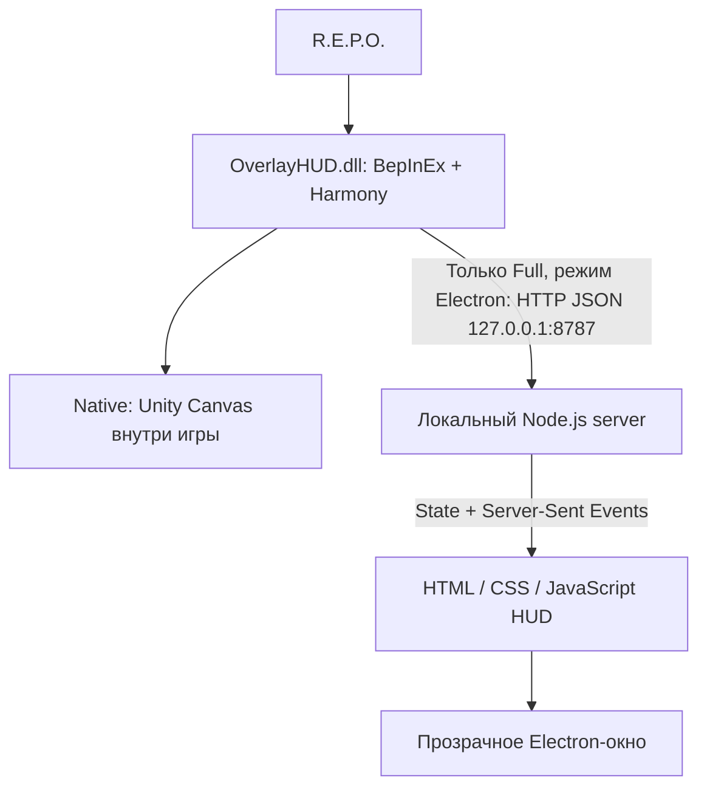

# OverlayHUD 26.11.4

Локальный HUD-оверлей для **R.E.P.O.**, который показывает информацию о текущем забеге внутри игры или в отдельном прозрачном окне.

**Автор: EgorSalad**  
**OverlayHUD целиком создан с использованием Codex AI.**
**Ныне поддерживается с помощью Claude Sonnet 5.**
**Версия 26.11.4: синхронизацию ХП необходимо проверить в игровом лобби перед публикацией.**

> OverlayHUD — неофициальный фанатский проект. Он не связан с semiwork, издателем R.E.P.O. или Thunderstore.

## Что нового в 26.11.4

Full и Native обновлены до версии 26.11.4. В пакет Native включён двуязычный README для Thunderstore (английский и русский) с явным раскрытием использования ИИ. В README пакета Full восстановлено указание на создание проекта с использованием Codex AI и поддержку с помощью ИИ.

В Full сохранено исправление локализации из 26.11.3: комплектное Electron-приложение использует официальные русские и английские названия в подсказках, в том числе для монстров без собственной иконки.

Перед обновлением закройте игру и уже запущенный OverlayHUD (Electron). Изменение SHA-256 комплектного `OverlayHUD_app.zip` запускает управляемое обновление приложения при следующем desktop-автозапуске с сохранением корневого конфига и таймкодов.

## Как выглядит OverlayHUD

**HUD во время игры:**


**Панель настроек:**


## Что делает мод

Доступны две альтернативные сборки одной версии и с одной идентичностью плагина:

| Архив | Состав и режим по умолчанию |
| --- | --- |
| `EgorSalad-OverlayHUD-26.11.4-Full.zip` | Native + Electron; по умолчанию **Electron**. Плагин распаковывает и запускает комплектное приложение, синхронизирует состояние забега и закрывает приложение после игры. Native выбирается в конфиге. |
| `EgorSalad-OverlayHUD-26.11.4-Native.zip` | Только Unity HUD внутри игры. Отдельная DLL без кода запуска приложения и HTTP-моста, без архива приложения и его настроек. |

**Устанавливайте только один вариант в профиль.** При смене сборки удалите прежний пакет, не оставляйте вторую DLL или остатки приложения в каталоге мода. Сохраните нужные timestamps. При переходе со старых версий или между сборками закройте игру, сохраните резервную копию и удалите `BepInEx/config/local.overlay.overlay_hud.cfg`: новый конфиг создаётся при следующем запуске. Старые секции и значения не мигрируют; нужные настройки задайте заново в новых секциях.

HUD умеет показывать:

- встреченных монстров и их уровень силы;
- текущее и максимальное здоровье монстров;
- состояние монстра и оставшееся время до респавна;
- номер уровня и таймер прохождения;
- улучшения игрока;
- текущую стоимость ценностей на карте;
- потерянную стоимость ценностей;
- кто последним держал предмет, упавший в пропасть и уничтоженный;
- отдельные timestamps прохождения уровней.

Монстры не раскрываются заранее. Плагин знает состав уровня для внутренней синхронизации статусов, но добавляет монстра в видимую часть HUD только после того, как игра зафиксировала встречу с ним.

## Возможности оверлея

### Экспериментальный HUD внутри игры

Режим `Native` рисует HUD через Unity Canvas: не запускает desktop-приложение
и не отправляет HTTP-запросы. В Full для его включения установите
`Renderer = Native` в `[01 General]` и перезапустите игру; значение по умолчанию — `Electron`.
В Native-only этот режим единственный, секции `[01 General]` и выбора Renderer нет.
Ниже Native-настройки со значениями по умолчанию; они одинаковы в обеих сборках.

```ini
[03 Native - General]
Enabled = true
Language = ru
SaveTimestamps = true

[04 Native - Layout]
Scale = 1
Alignment = Center
OffsetX = 0
OffsetY = 20
HorizontalLayout = true
HorizontalColumns = 11
Columns = 4
MonsterSize = 70
UpgradeSize = 38
UpgradeRows = 2
WrapValueLabels = true

[05 Native - Information]
ShowLevel = true
ShowTimer = true
ShowMapValue = true
ShowLostValue = true
ShowUpgrades = true

[06 Native - Monsters]
ShowMonsters = true
ShowHealth = true
ShowRespawnTimer = true
ShowRespawnIndicator = true
ShowStrength = true
ShowMonsterCounts = true
OnlyAliveMonsters = false
FilterUndetectedMonsters = false

[07 Native - Effects]
UseGameUIEffects = true
ShowProximityWaves = true
ShowDamageNumbers = true
Animations = true
ShowDestroyedItemAlerts = false
ShowTooltips = false

[08 Native - Upgrades]
strength = true
tumbleLaunch = true
range = true
sprintSpeed = true
tumbleWings = true
crouchRest = true
extraJump = true
tumbleClimb = true
health = true
stamina = true
mapPlayerCount = true
deathHeadBattery = true
```

**Смена `Renderer` в Full требует перезапуска игры.** Все параметры секций
`03 Native - General` — `08 Native - Upgrades`, включая компоновку и колонки,
применяются на лету через BepInEx Configuration Manager или перезагрузку конфига
средствами BepInEx. Автоматического наблюдения за cfg-файлом нет: ручное
редактирование требует перезагрузки конфига либо игры.
В Full `Renderer = Electron` возвращает desktop-интерфейс; при ошибке создания
Canvas/загрузки ресурсов Full также возвращается к Electron на текущую сессию.
Native-only при такой ошибке пишет причину в лог, другого рендерера в нём нет.

**Компоновка и размеры**

| Параметр | Назначение |
| --- | --- |
| `HorizontalLayout` | `true` — компактная верхняя строка, монстры используют `HorizontalColumns`; `false` — верхние блоки переносятся по ширине сетки, используется `Columns`. **В обоих режимах** лишние монстры переходят на следующий ряд, а не скрываются. |
| `HorizontalColumns` / `Columns` | Максимум плиток в ряду: 1–24, по умолчанию 11 / 4. Неактивный для текущего режима параметр игнорируется. |
| `Alignment` | `Left`, `Center`, `Right`: привязка всей панели к левому краю, центру или правому краю экрана, а также выравнивание содержимого шапки и рядов монстров. |
| `OffsetX` / `OffsetY` | Смещение от выбранной горизонтальной привязки (плюс — вправо, −1920…1920) / отступ сверху (0–1080), в масштабируемых пикселях HUD. Положение ограничено краями экрана с полями. |
| `Scale` | 0.5–2; `1` — базовый размер при 1920×1080. Масштаб учитывает обе стороны окна (`min(width/1920, height/1080)`), затем ограничивается размерами панели. Это устраняет лишнее увеличение на 16:10 и 4:3. DPI/zoom и сохранённые настройки Electron всё ещё могут давать отличия. |
| `MonsterSize` / `UpgradeSize` | Размер плитки монстра 32–128 / иконки улучшения 20–64 до общего масштаба; по умолчанию **70 / 38 px**. Улучшения сохраняют пропорции (при 38 px область вписывания — 31.16 × 38 px). |
| `UpgradeRows` | 1 или 2 ряда улучшений, по умолчанию 2 сбалансированных; сортировка по количеству. В узкой сетке возможны дополнительные переносы. |
| `WrapValueLabels` | `true` — подписи карты/потерь над суммами; `false` — в одной строке с ними. |

**Видимость и эффекты** (по умолчанию `true`, кроме `ShowDestroyedItemAlerts`)

| Группа | Переключатели и действие |
| --- | --- |
| Весь HUD | `Enabled` скрывает HUD, не останавливая отслеживание игрового состояния и запись timestamps. |
| Верхняя панель | `ShowLevel`, `ShowTimer`, `ShowMapValue`, `ShowLostValue` независимо показывают уровень, таймер, цену карты и потери. Таймер поддерживает часы; нулевые суммы скрыты. |
| Монстры | `ShowMonsters` скрывает только плитки, не шапку/улучшения; `ShowMonsterCounts` управляет счётчиками групп. |
| Здоровье | `ShowHealth` управляет **полосками** ХП. Числа текущего/максимального ХП доступны в подсказках независимо от этого переключателя. |
| Респавн | `ShowRespawnTimer` — числовой отсчёт `м:сс`; `ShowRespawnIndicator` — круговой сектор оставшегося времени. Независимы друг от друга; неизвестный/истёкший отсчёт не висит как `00:00`. |
| Сила | `ShowStrength` — требуемое число улучшений у обнаруженных монстров, **включая респавн**. Зелёный — силы хватает, красный — нет; янтарные `X` — поднять нельзя, `?` — данных нет. |
| Улучшения | `ShowUpgrades` — полученные улучшения с количеством; каждый из 12 ключей `[08 Native - Upgrades]` отдельно включает/скрывает свой тип. Нулевые количества скрыты. |
| Эффекты | `ShowProximityWaves` — волны близости; `ShowDamageNumbers` — всплывающий урон. `Animations = false` отключает переходы, волны, вспышки и числа урона; числовые таймеры продолжают обновляться. |
| Уведомления | `ShowDestroyedItemAlerts = false` — при включении показывает уничтоженный предмет и последнего державшего его игрока. |

**Язык, подсказки и фильтры**

| Параметр | Поведение |
| --- | --- |
| `Language = ru` | Русские подписи по умолчанию; `en` — английские. Подсказки монстров и улучшений используют официальные названия из таблицы `HUD` игры (`ENEMY.*` и `STATS.UPGRADE.*`), не меняя язык игры. Если перевод недоступен — английское/исходное название. Имена игроков и предметов не переводятся. |
| `ShowTooltips = false` | При `true` наведение на обнаруженного монстра известного вида показывает имя, ХП и силу, на улучшение — локализованное название. Работает **только с разблокированным игровым курсором**: HUD не разблокирует и не захватывает его, не перехватывает клики. Подсказки удерживаются в пределах экрана. Для их использования отключите `UseGameUIEffects`, который по умолчанию включён. |
| `OnlyAliveMonsters = false` | При `true` скрывает погибших обнаруженных монстров до респавна; необнаруженные заглушки по умолчанию сохраняются. |
| `FilterUndetectedMonsters = false` | Действует **только вместе с `OnlyAliveMonsters = true`**: дополнительно удаляет погибшие необнаруженные заглушки. Живые необнаруженные остаются; сам по себе параметр ничего не фильтрует. |

Необнаруженные монстры остаются заглушками без раскрытия вида, ХП и состояния.
Группы объединяются в плитки (`x4` гномов, `x3` Banger), несколько полных групп —
в отдельные плитки; обычные одиночные монстры не объединяются. ХП группы суммируются,
счётчик отражает полученные экземпляры, группа жива, пока жив хотя бы один участник;
после гибели всех показывается ближайший известный респавн. До встречи — одна
заглушка без счётчика. Сила вычисляется из игровых параметров захвата, не из таблицы
имён: для группы берётся максимальное известное требование, невозможность поднять
хотя бы одного участника даёт `X`.

Карточки сортируются по игровому тиру; рамки зелёные, синие, красные, при неизвестном
тире — золотистые. Есть свечение по силуэту, тени, плавное появление и смена изображения,
анимация ХП, вспышки и числа урона. Полоска ХП меняет цвет при 60%, 30% и 10%;
сокращение респавна выделяется красным, волны ускоряются при очень близком монстре.
Блик неизвестного вида появляется только после обнаружения, не на скрытых слотах.

Уведомление об уничтожении показывается **6 секунд**, новое заменяет предыдущее
без очереди. При отключённых уведомлениях события считаются обработанными и не
воспроизводятся после включения; скрытие HUD не приостанавливает их срок.
Смена уровня сбрасывает уведомление. Оформление повторяет Electron: компактная
однострочная красная плашка, Teko 26, верхний регистр, розовые имена и светлый глагол,
плавное появление/сдвиг. Вместо emoji используется векторный значок взрыва.
Уведомление размещается над/под панелью и ограничивается экраном даже при крайних
смещениях; длинный текст сокращается.

**Локальные timestamps**

`SaveTimestamps = true` сохраняет отдельный UTF-8 `.txt` на сессию в
`BepInEx/plugins/OverlayHUD/timestamps` (имя файла — локальные дата/время).
Записываются локальное время начала, номер уровня, название карты, имена и количества
встреченных монстров; **имена игроков модуль записи не сохраняет**, данные никуда не загружаются.
`false` завершает текущую запись и останавливает дальнейшую; после включения запись
возобновляется **со следующего уровня**, без восстановления пропущенных уровней.

**Штатные эффекты игрового HUD (экспериментально)**

`UseGameUIEffects = true` выводит Native через отдельную UI-камеру игры: она применяет
свои искривление линзы, хроматическую аберрацию и bloom, как к родному HUD.
По умолчанию включено; `false` оставляет независимый чёткий оверлей. Это общий тракт
обработки изображения HUD, а не отдельные анимации HP, стамины или квоты.
Переключение применяется без перезапуска.
Это не новый шейдер: профиль эффектов, материалы, камеры и текстуры игры не изменяются.

- При включении используются пропорции и область игрового HUD, в том числе на ultrawide;
  масштаб и положение могут немного отличаться от независимого оверлея.
- Резкость ограничена разрешением UI-текстуры игры: текст может стать мягче/пиксельнее.
- Hover-подсказки временно отключаются: обычные координаты курсора не учитывают искривление.
- Если игровая UI-камера недоступна, Native возвращается к обычному выводу и повторяет
  подключение раз в 0.5 секунды; после смены сцены подключается к новым объектам.
- В логе BepInEx сообщения `Native HUD game UI effects active/unavailable/disabled`
  показывают текущий режим. Визуальное действие эффекта требует проверки в игре.

**Ограничения и проверки**

Иконки и растровые атласы Teko с утолщённым начертанием, Roboto Bold/ExtraBold
встроены в DLL; установка шрифтов не нужна. Подписи «УРОВЕНЬ», «КАРТА», «ПОТЕРЯ»
используют кириллицу из Teko в тех же размерах, что английские подписи в Electron;
Roboto остаётся у бейджей, подсказок и уведомлений. Набор глифов ограничен ASCII и частью кириллицы (U+0400–U+045F):
символы вне доступного атласа, включая многие не-ASCII символы и расширенную кириллицу,
заменяются на `?`, системного шрифтового fallback нет. При увеличении текст может быть
мягче браузерного; Unity Canvas и растровые шрифты не гарантируют попиксельного совпадения.

Ещё не перенесены drag-and-drop, web-панель настроек, трей и скриншоты; импорта
сохранённых настроек браузера нет. Native настраивается собственным конфигом.
Скрытие при карте и счётчике квоты сохранено; в Native квота скрывает HUD
**при любых смещениях**, не только у верхнего края.

Команды из корня репозитория:

- Пересборка ресурсов: `uv run --with pillow python tools/build-native-assets.py`.
- Сборка плагина: `dotnet build overlay-hud/OverlayHUD.csproj -c Release`.
- Проверки состояния, событий и вспомогательной логики Native: `dotnet run --project tests/native-hud/NativeHud.Tests.csproj`.
- Проверки официальных имён, ru/en, fallback и загрузки локализации: `dotnet run --project tests/localization/Localization.Tests.csproj`.
- Сверка тестовых названий с установленной игрой: `uv run --with UnityPy==1.25.4 python tests/localization/verify-game-tables.py "<путь к REPO_Data>"`.

Эти проверки не заменяют реальный забег: отображение, курсор и совместимость
с игровым UI требуют отдельной runtime-проверки.

### Desktop HUD

- прозрачное окно поверх игры;
- пропуск кликов сквозь окно;
- перетаскивание и привязка к краям или центру экрана;
- изменение общего масштаба и отдельного масштаба улучшений;
- настройка количества колонок с монстрами;
- одинарная или двойная строка улучшений;
- русский и английский интерфейс;
- официальные ru/en-названия монстров и улучшений в подсказках, как в Native: плагин обновляет переводы из игры, до загрузки используются комплектные официальные таблицы; смена языка применяется сразу;
- уведомления об уничтожении с 💥; по умолчанию выключены, как и подсказки (язык по умолчанию — `ru`); сохранённые настройки не сбрасываются;
- включение и отключение отдельных элементов HUD;
- настройка фоновой панели и прозрачности при наведении;
- появление HUD и запуск таймера после загрузки, когда игрок получает управление;
- скрытие HUD на время просмотра карты (включая анимацию закрытия, независимо от назначенной клавиши);
- скрытие HUD во время показа счётчика денег `CurrencyUI` при сдаче квоты, только если HUD примагничен к верхнему краю экрана; нижняя, центральная и свободная позиции не скрываются;
- сохранение пользовательских настроек между запусками.

Для desktop-оверлея доступны глобальные горячие клавиши:

| Сочетание | Действие |
| --- | --- |
| `Ctrl+Alt+O` | Показать или скрыть окно |
| `Ctrl+Alt+I` | Включить или выключить пропуск кликов |
| `Ctrl+Alt+R` | Перезагрузить страницу оверлея |
| `Ctrl+Alt+Q` | Закрыть OverlayHUD |

Те же действия доступны через значок OverlayHUD в системном трее.

## Как это работает



### Игровой плагин

`overlay-hud/Plugin.cs` загружается через BepInEx и с помощью Harmony подписывается на игровые события:

- генерацию и смену уровня;
- создание, исчезновение и респавн врагов;
- события видимости и близости монстров;
- изменение здоровья монстров;
- получение улучшений;
- изменение, разрушение и сдачу ценностей.

Большая часть синхронизации событийная. Периодические проходы используются только как страховка, а reflection-метаданные, источники здоровья и результаты проверок компонентов кэшируются, чтобы снизить нагрузку на Unity.

### Локальный сервер

`server.js` хранит состояние HUD и принимает обновления от плагина через локальные `/api/...` endpoints. Страница оверлея получает новые состояния через Server-Sent Events и не выполняет постоянный тяжёлый polling.

В packaged-приложении сервер слушает только `127.0.0.1:8787`: данные не отправляются во внешний интернет, телеметрии нет.

> При ручном запуске через `start-server.bat` используется стандартный host из `server.js` — `0.0.0.0`. Такой режим может открыть порт `8787` в локальной сети. Для обычной установки через r2modman это не используется.

### Desktop-приложение

`game-overlay/main.js` создаёт прозрачное click-through окно Electron, запускает встроенный сервер и открывает `http://127.0.0.1:8787/overlay.html`.

Во время загрузки уровня и вне активного игрового уровня приложение скрывает само прозрачное окно, а не только содержимое HUD, и останавливает проверки наведения курсора. Для скрытого окна разрешено фоновое ограничение активности Chromium. Локальный сервер и получение состояния продолжают работать, поэтому HUD возвращается автоматически после загрузки; ручное скрытие через трей или хоткей сохраняется до повторного включения. Для этого поведения нужно обновить desktop-приложение вместе с веб-ресурсами; DLL менять не требуется.

Архив `OverlayHUD_app.zip` остаётся рядом с DLL мода. По умолчанию плагин устанавливает и запускает приложение вне каталога мода:

```text
%LOCALAPPDATA%\OverlayHUD\profiles\<profile-key>\app\OverlayHUD.exe
```

`<profile-key>` — SHA-256 нормализованного `BepInExRootPath`. Файлы приложения, корневой `overlay-config.json` и `timestamps/` изолированы по профилям BepInEx. Настройки web-панели в Electron `localStorage` остаются в прежнем хранилище Electron: изоляция браузерных профилей не меняется.

## Установка через r2modman

1. Откройте r2modman, выберите R.E.P.O. и создайте или выберите профиль.
2. В настройках профиля (`Settings`) найдите `Import local mod` и выберите **один** архив: `EgorSalad-OverlayHUD-26.11.4-Full.zip` или `EgorSalad-OverlayHUD-26.11.4-Native.zip`. Предварительно распаковывать ZIP не нужно.
3. Убедитесь, что в профиле установлен BepInExPack.
4. Запустите игру через кнопку `Start modded` в r2modman.
5. Full по умолчанию распакует и запустит `OverlayHUD.exe`; Native-only покажет HUD прямо в игре после загрузки уровня.

Для ручной установки поместите файлы выбранного архива в `BepInEx/plugins/OverlayHUD/`. Не смешивайте файлы разных вариантов.

Node.js и Electron отдельно устанавливать не требуется: Full включает приложение, а Native-only его не использует. Следующие подразделы о desktop-приложении относятся только к Full в режиме Electron.

### Перенос и обновление desktop-приложения

Перед обновлением или подготовкой к переносу закройте **игру и OverlayHUD**. Не удаляйте старую папку `OverlayHUD_app` рядом с DLL: при следующем desktop-автозапуске (`AutoStart=true` в `[09 Electron - App]`) плагин скопирует распознанную старую установку во внешнюю папку целиком, включая `overlay-config.json`, `timestamps/` и неизвестные файлы. Обновление из архива применяется с сохранением корневого конфига и timestamps; старая папка удаляется только после успешного переноса. Native HUD не запускает перенос, его timestamps остаются на прежнем месте.

Если старая и внешняя установки уже существуют одновременно, старая остаётся нетронутой, а лог предупреждает о необходимости ручной проверки. Если удалению после переноса мешают заблокированные файлы, плагин также пишет предупреждение.

Изменение SHA-256 архива автоматически запускает обновление через промежуточную папку: вручную удалять приложение не нужно. При ошибке исходная установка сохраняется, запуск отменяется. Для самого переноса достаточно обновлённой DLL и существующего `OverlayHUD_app.zip`; пересборка Electron не требуется.

Внешние файлы сохраняются после удаления мода или профиля в менеджере модов. Для полной очистки закройте приложение, сохраните нужные `timestamps/` и `overlay-config.json`, затем вручную удалите соответствующую папку `%LOCALAPPDATA%\OverlayHUD\profiles\<profile-key>`.

### Режим отображения игры

Используйте оконный или borderless-режим. Обычное desktop-окно не может отображаться поверх игры в exclusive fullscreen.

Скрытие при сдаче квоты зависит только от привязки HUD к верхнему краю (`anchorY: top`), а не от координат `CurrencyUI`. Исходное положение без ручного перемещения также считается верхним. Горизонтальная привязка не влияет на это правило. При открытии карты HUD скрывается в любом положении. Для новой логики нужны обновлённые DLL и desktop-приложение.

## Конфигурация

После первого запуска BepInEx создаёт файл:

```text
BepInEx/config/local.overlay.overlay_hud.cfg
```

Используются только новые нумерованные секции. Старые `[Overlay]`, `[Detection]`, `[NativeHUD]`, `[NativeHUD.Upgrades]`, `[OverlayApp]` и `[Debug]` не поддерживаются. При смене сборки или переходе со старой схемы создайте чистый конфиг, как описано выше; автоматического переноса значений нет.

| Секция | Параметры и значения по умолчанию |
| --- | --- |
| `01 General` — только Full | `Renderer = Electron`; альтернатива `Native`. Смена требует перезапуска игры. |
| `02 Detection` | `ScanIntervalSeconds = 3`, `StatusIntervalSeconds = 10`, `RequireLineOfSight = true`, `RevealUnknownMonsters = false`, `PreferPlayerVisionDetection = true`. |
| `03 Native - General` | `Enabled = true`, `Language = ru` (или `en`), `SaveTimestamps = true`. |
| `04 Native - Layout` | `Alignment = Center`, `Scale = 1`, `OffsetX = 0`, `OffsetY = 20`, `HorizontalLayout = true`, `HorizontalColumns = 11`, `Columns = 4`, `MonsterSize = 70`, `UpgradeSize = 38`, `UpgradeRows = 2`, `WrapValueLabels = true`. |
| `05 Native - Information` | `ShowLevel`, `ShowTimer`, `ShowMapValue`, `ShowLostValue`, `ShowUpgrades` — все `true`. |
| `06 Native - Monsters` | `ShowMonsters`, `ShowHealth`, `ShowRespawnTimer`, `ShowRespawnIndicator`, `ShowStrength`, `ShowMonsterCounts` — `true`; `OnlyAliveMonsters`, `FilterUndetectedMonsters` — `false`. |
| `07 Native - Effects` | `Animations`, `ShowProximityWaves`, `ShowDamageNumbers`, `UseGameUIEffects` — `true`; `ShowDestroyedItemAlerts`, `ShowTooltips` — `false`. |
| `08 Native - Upgrades` | 12 переключателей улучшений, все `true`; полный список в примере Native выше. |
| `09 Electron - App` — только Full | `AutoStart = true`, `AutoClose = true`, `ExecutableRelativePath` — пусто, `ArchiveName = OverlayHUD_app.zip`. |
| `10 Electron - Connection` — только Full | `Endpoint = http://127.0.0.1:8787/api/monster-seen`, `LevelEndpoint = http://127.0.0.1:8787/api/level`. |
| `99 Diagnostics` | `Logging = false`; `true` включает подробный BepInEx-лог. |

Native-only не создаёт секции `01 General`, `09 Electron - App`, `10 Electron - Connection`: это отдельная сборка DLL, а не Full с изменённым значением Renderer.

Пустой `ExecutableRelativePath` выбирает внешнюю установку для профиля. Пользовательский относительный путь считается от DLL, абсолютный используется напрямую; внешний перенос к пользовательским путям не применяется. Перенос **файлов** приложения, описанный выше, не означает миграцию старых секций конфига.

Значения `StatusIntervalSeconds` меньше `10` поднимаются до `10`. `RequireLineOfSight=false` раскрывает весь состав уровня сразу; `RevealUnknownMonsters=true` раскрывает новые виды с иконкой-заглушкой, не меняя правил для известных видов. По умолчанию монстры появляются только после встречи.

Цвет обводки обнаруженных монстров берётся из игровой категории `EnemyParent.difficulty`: 1 — зелёный, 2 — синий, 3 — красный. Если категория недоступна или некорректна, обводка золотая. Это действует и для известных, и для новых монстров. Если мод оставил игровую категорию по умолчанию, она считается первым уровнем.

Новые и модовые монстры используют `assets/monsters/new.webp` с золотистым бликом по рисунку раз в 8 секунд. HP и требуемая сила берутся из игровых компонентов для всех монстров, включая известных; статическая таблица силы больше не используется. Порог `grabForceNeeded.amount` пересчитывается в число улучшений силы для одного стоящего игрока с учётом `PhysGrabber.forceMax`, прочитанного из игры (в стандартных игровых ассетах — 6). Для групповой плитки показывается максимум доступных значений.

Игровой ресурс `Grab Force - Ungrabbable` отображается как «нельзя поднять», а не как огромное количество улучшений. Если данные недоступны, отображается `?`, без подстановки старого табличного значения. Число не гарантирует возможность захвата при временных запретах или изменённой модами механике; независимые от `EnemyParent`/`Enemy` системы врагов требуют отдельной поддержки.

Настройки интерфейса сохраняются отдельно от состояния забега и восстанавливаются после перезапуска EXE или игры. Синхронизация настроек не восстанавливает старых монстров, таймер и игровые значения. Уже потерянные до этого исправления настройки необходимо выставить заново.

ПКМ по значку OverlayHUD в трее открывает дополнительные действия:

- **Монитор** — выбор экрана при нескольких подключённых мониторах. Выбор сохраняется в `overlay-config.json` рядом с приложением; подключение и отключение экранов обрабатывается автоматически.
- **Язык / Language** — русский или английский язык оверлея и новых таймкодов. Выбор синхронизируется с языком в панели настроек оверлея и сохраняется между запусками.
- **Прочее** — показать или скрыть оверлей, включить **Взаимодействовать с оверлеем** или **Сохранять таймкоды**. Галочка взаимодействия означает, что оверлей принимает клики; без неё клики проходят в игру. Сохранение таймкодов по умолчанию включено; выбор сохраняется между запусками.
- **Сделать скриншот** — снимок текущего окна HUD на прозрачном фоне с выбором файла. Предлагаемое имя содержит местные дату и время без пробелов: `OverlayHUD_2026-10-12_21-04-05-006.png`. Игра и рабочий стол в снимок не попадают. Оверлей должен быть показан и загружен; включённая подложка HUD и открытые элементы управления остаются на снимке.

Аппаратное ускорение Electron включено по умолчанию. Через пункт **Аппаратное ускорение (перезапуск)…** в трее его можно отключать и включать. После подтверждения настройка сохраняется в `overlay-config.json`, и только приложение оверлея перезапускается; игра продолжает работать. Отмена не меняет настройку. Программный рендеринг может увеличить нагрузку на CPU.

При `AutoClose=true` в `[09 Electron - App]` автоматически запущенный оверлей отслеживает процесс игры и закрывается после её выхода, в том числе после перезапуска при смене аппаратного ускорения. Для этого нужны обновлённые DLL плагина и desktop-приложение. На оверлей, запущенный вручную, это правило не распространяется.

Проверка процесса игры выполняется раз в секунду и работает также после краша игры. При начале закрытия оверлей даёт Electron 5 секунд на штатный выход, затем принудительно завершает собственное приложение. Отсутствие игровых данных не вызывает закрытие: пауза и загрузка не считаются выходом из игры.

Повторный запуск передаётся существующему экземпляру средствами Electron. Запуск из плагина с `AutoClose=true` привязывает его к игре, если у него ещё нет привязки или прежний процесс игры уже завершился. Привязка к работающей игре не заменяется. Поиск и уничтожение чужих процессов по имени или занятому порту не используются. Полностью зависший главный поток Electron не сможет выполнить внутренний таймер; такой экземпляр потребуется завершить через Диспетчер задач. Ранее установленное старое приложение также нужно закрыть вручную перед обновлением.

## Timestamps

Desktop HUD создаёт текстовые файлы в `timestamps/` рядом с `OverlayHUD.exe`. Путь по умолчанию:

```text
%LOCALAPPDATA%\OverlayHUD\profiles\<profile-key>\app\timestamps\YYYY-MM-DD_HH-MM-SS.txt
```

При пользовательском пути к EXE папка `timestamps/` по-прежнему находится рядом с ним. Путь timestamps Native HUD не изменён.

Пример строки:

```text
22:14:09 Уровень 42 SA [Смотритель, Гном x8, Главарь]
```

Язык новых строк соответствует языку оверлея: на английском тот же пример выглядит как `22:14:09 Level 42 SA [Peeper, Gnome x8, Headman]`. Названия локаций (`MoHA`, `HM`, `SA`, `MS`) не переводятся. Уже начатая строка завершается на том языке, на котором была создана.

Названия монстров берутся из официальных русской и английской таблиц `HUD` игры: например, `Snatcher` записывается как `Пони` / `Pony`. Плагин загружает обе таблицы независимо от выбранного языка игры и передаёт названия серверу. Пока таблицы недоступны, используется включённая в приложение копия названий, извлечённая из игровых пакетов локализации. Для этой синхронизации нужны обновлённые плагин и desktop-приложение. Старые файлы таймкодов не переписываются.

Неизвестные монстры и локации записываются исходными именами из игры, без перевода и сокращений. У названий локаций убирается служебный префикс `Level - `.

Галочка **Прочее → Сохранять таймкоды** отключает запись без удаления существующих файлов. При отключении текущая строка завершается; после повторного включения запись возобновляется со следующего уровня.

## Диагностика

Главный источник информации — свежий `BepInEx/LogOutput.log` из того профиля r2modman, через который действительно запускалась игра.

Полезные строки:

- `Loading [OverlayHUD ...]` — загруженная версия DLL;
- `Bundled OverlayHUD desktop app ready at:` — внешняя установка готова; далее указан фактический путь к EXE;
- `Extracted bundled OverlayHUD desktop app` — распаковка только для пользовательского пути установки;
- `Started bundled OverlayHUD desktop app` — `OverlayHUD.exe` запущен;
- `Registered spawned enemy parent` — враг зарегистрирован во внутреннем roster;
- `Marked monster for web overlay` — условие встречи с монстром сработало;
- `HTTP/1.1 200 OK` — локальный сервер принял обновление.

Если вместо прозрачного фона виден чёрный экран, снимите галочку **Аппаратное ускорение (перезапуск)…** в трее и подтвердите перезапуск оверлея. Альтернатива — указать `"hardwareAcceleration": false` в `overlay-config.json` и перезапустить приложение вручную. Для старых сборок обходной путь — запуск `OverlayHUD.exe --disable-gpu`.

Пустой список монстров не скрывает HUD: таймер, ценности и улучшения показываются и на уровнях без врагов. Повреждения и разрушение ценностей в комнате сдачи учитываются в потерях; штатная сдача предметов — нет.

Для Native проверьте `Enabled` в `[03 Native - General]`, наличие строки `Native HUD initialized` и ошибок создания HUD в логе. В Full также проверьте выбранный `Renderer`.

Если не появляется Electron HUD (только Full):

1. Проверьте, что игра запущена в windowed/borderless-режиме.
2. Проверьте путь к EXE из строки `Bundled OverlayHUD desktop app ready at:` и предупреждения о переносе/обновлении; для пользовательской установки — `ExecutableRelativePath` в `[09 Electron - App]`. Архив `OverlayHUD_app.zip` должен оставаться рядом с DLL.
3. Убедитесь, что порт `8787` не занят другим процессом.
4. Временно включите `Logging = true` в `[99 Diagnostics]`.
5. Приложите свежий `LogOutput.log` к отчёту об ошибке.

## КД монстров в мультиплеере

Для точного отсчёта у подключённого игрока обновлённый OverlayHUD должен быть установлен и у него, и у хоста. Хост раз в секунду передаёт таймеры через Photon только игрокам, объявившим поддержку протокола OverlayHUD. Отдельные серверы, порты и настройки не нужны; desktop-приложение обновлять для этой функции не требуется.

Клиент принимает данные только от текущего хоста, учитывает задержку доставки и сопоставляет монстров по сетевому ID. Получение таймера не раскрывает невстреченных монстров. При смене уровня, комнаты или хоста сетевые данные сбрасываются. Если у хоста нет поддержки синхронизации, клиент продолжает показывать состояние монстра без точного КД; случайный локальный таймер не используется.

Передача КД проверена пользователем в мультиплеере. Начиная с 26.11.2 хост также передаёт текущее и максимальное ХП: сразу после события урона и контрольным снимком раз в секунду. Клиент использует эти значения для полоски здоровья и цифр нанесённого урона. Это потеря ХП монстра от любых источников, а не персональный счётчик урона игрока. Для передачи ХП обновление требуется у хоста и клиентов; со старыми клиентами сохраняется передача КД. Синхронизацию ХП необходимо проверить в игровом лобби перед публикацией сборки.

## Ограничения

- Harmony-патчи и reflection зависят от внутреннего API R.E.P.O. и могут потребовать обновления после патчей игры.
- `EnemyOnScreen` работает не одинаково для всех типов врагов. Для `Tick` и `Upscream` используется узкий fallback через старую логику видимости/близости.
- Точность стоимости карты зависит от игровых событий ценностей и момента генерации уровня.
- OverlayHUD рассчитан на локальный desktop HUD и не является заменой полноценному OBS Browser Source для удалённого компьютера.

## Структура репозитория

```text
assets/                 Шрифты, иконки монстров и улучшений
game-overlay/           Electron host и scripts упаковки
overlay-hud/            BepInEx/Harmony плагин и структура пакетов мода
overlay.html            Разметка и клиентская логика HUD
overlay.css             Стили и анимации
overlay-state.js        Состояние, настройки и SSE-клиент
server.js               Локальный HTTP/SSE-сервер
start-server.bat        Ручной запуск web-сервера для разработки
```

Содержимое `bin/`, `obj/`, `dist/`, `node_modules/`, `.electron-cache/`, DLL-копии package layouts и release-архивы генерируются локально и не хранятся в Git.

## Сборка из исходников

### Требования

- Windows;
- .NET SDK с поддержкой `net472`;
- установленная R.E.P.O. для Unity reference assemblies;
- Node.js, npm и установленные зависимости `game-overlay/` — для рекомендуемой релизной сборки с `-RebuildDesktop`; повторное использование проверенного актуального архива не требует пересборки Electron;
- BepInEx/Harmony reference assemblies.

Пути к Unity DLL сейчас заданы в `overlay-hud/OverlayHUD.csproj` через стандартный Steam-каталог. При другой установке игры измените `HintPath`.

### BepInEx-плагин

```powershell
dotnet build overlay-hud/OverlayHUD.csproj -c Release
```

Результат:

```text
overlay-hud/bin/Release/net472/OverlayHUD.dll
```

Это обычная сборка Full. Для выпуска двух вариантов используйте скрипт ниже: он сам собирает разные DLL и не изменяет существующие package-копии. Не подменяйте Native DLL результатом Full-сборки.

### Electron-приложение

```powershell
cd game-overlay
npm install
npm run package
```

Результат:

```text
game-overlay/dist/OverlayHUD-win32-x64/
```

Сборка использует `--no-asar`: код приложения лежит в обычной папке `resources/app/`. Не включайте ASAR: Electron-менеджеры модов могут воспринимать `app.asar` как виртуальный каталог и выдавать `EBUSY` при удалении мода. Плагин поддерживает оба формата и автоматически переносит распознанную старую установку за пределы каталога мода; удалять её до переноса не нужно.

При создании `OverlayHUD_app.zip` перечисляйте верхнеуровневые файлы и каталоги явно. Архивация через `tar -C <dir> .` добавляет нежелательную запись `./`.

### Два flat-пакета для локального импорта и Thunderstore

Из корня репозитория (Windows PowerShell 5.1 или PowerShell 7). Для релиза рекомендуется пересобрать Electron:

```powershell
powershell -NoProfile -File tools/Build-Packages.ps1 -RebuildDesktop
# Повторная релизная сборка с заменой двух результатов предыдущего запуска:
powershell -NoProfile -File tools/Build-Packages.ps1 -RebuildDesktop -Force
# Без пересборки: только если существующий комплектный архив полностью актуален:
powershell -NoProfile -File tools/Build-Packages.ps1
# Альтернатива: другой уже собранный актуальный архив приложения:
powershell -NoProfile -File tools/Build-Packages.ps1 -BundlePath "C:\build\OverlayHUD_app.zip"
```

`-RebuildDesktop` запускает `npm.cmd run package` в `game-overlay/` и создаёт свежий `OverlayHUD_app.zip` в staging; существующий входной архив не перезаписывается. Зависимости приложения должны быть установлены заранее (см. выше). `-BundlePath` нельзя совмещать с `-RebuildDesktop`; относительный путь считается от рабочего каталога вызывающего процесса.

Скрипт собирает Release дважды с `NativeOnly=false` и `NativeOnly=true`, раздельными `obj/Full/` и `obj/NativeOnly/` и раздельными выходными папками. Временная сборка, staging и проверенные архивы остаются в `overlay-hud/dist/packages/<run-id>/`; в ZIP попадают только явно перечисленные файлы, не PDB/obj/конфиги. Версия берётся из manifest и сверяется с проектом; версия не повышается.

Без `-RebuildDesktop` используется существующий `overlay-hud/package-flat/OverlayHUD_app.zip` либо архив из `-BundlePath`. Он допускается только при совпадении версии приложения с релизом и SHA-256 веб-файлов, файлов приложения и всех файлов `assets/` с текущими исходниками. Устаревшее или неполное содержимое отклоняется с указанием пересобрать desktop; одной новой DLL для исправления старого Electron-бандла недостаточно. Свежий архив проходит те же проверки. Скрипт собирает оба варианта и проверяет точный состав обоих ZIP до копирования в корень. Без `-Force` любой уже существующий выходной ZIP останавливает работу до сборки. Даже с `-Force` архив `EgorSalad-OverlayHUD-26.11.2.zip` **никогда не затрагивается**.

Результаты в корне: `EgorSalad-OverlayHUD-26.11.4-Full.zip` и `EgorSalad-OverlayHUD-26.11.4-Native.zip`.

Full содержит ровно 7 записей без каталогов:

```text
icon.png
manifest.json
OverlayHUD.dll
OverlayHUD_app.zip
README.md
LICENSE
THIRD_PARTY_NOTICES.md
```

Native содержит ровно 6 записей: тот же список **без `OverlayHUD_app.zip`**, с отдельной Native DLL, собственными README, описанием manifest и notices без компонентов desktop-приложения. Шаблоны Full находятся в `overlay-hud/package-flat/`, Native — в `overlay-hud/package-native/`; icon и MIT LICENSE общие. `name`, `author`, `version_number` и зависимости manifest совпадают: это взаимоисключающие варианты, не два одновременно устанавливаемых мода.

Скрипт печатает SHA-256 DLL и итоговых ZIP. Проверка содержимого ZIP не заменяет тесты DLL и запуск обеих сборок в игре.


**Обновление существующей установки:** закройте игру и OverlayHUD перед импортом. Сохраните старую папку `OverlayHUD_app` для автоматического переноса; изменение SHA-256 `OverlayHUD_app.zip` вызовет staged-обновление при desktop-автозапуске (см. «Перенос и обновление desktop-приложения»).


## Зависимости и acknowledgements

### Обязательные зависимости

- [BepInExPack for R.E.P.O.](https://thunderstore.io/c/repo/p/BepInEx/BepInExPack/) — загрузка плагина.
- [Harmony](https://github.com/pardeike/Harmony) — безопасные runtime-патчи игровых методов; поставляется через BepInEx.
- Только Full: [Electron](https://www.electronjs.org/) — прозрачное desktop-окно.
- Только Full: [Node.js](https://nodejs.org/) — локальный сервер внутри packaged Electron-приложения.

Для конечного пользователя отдельная установка Harmony, Electron или Node.js не требуется.

Также проект использует игровые API и типы из R.E.P.O./Unity. Все соответствующие названия, изображения и торговые марки принадлежат их правообладателям.

### Шрифты

- [Roboto](https://fonts.google.com/specimen/Roboto)
- [Teko](https://fonts.google.com/specimen/Teko)

Оба шрифта распространяются по лицензии SIL Open Font License 1.1. Тексты лицензий и сведения об авторах находятся рядом со шрифтами в `assets/fonts/`.

## Лицензия

Исходный код OverlayHUD распространяется по лицензии [MIT](LICENSE).

Шрифты, зависимости, игровые изображения, торговые марки и другие сторонние материалы не перелицензируются под MIT. Их условия и сведения об авторстве перечислены в [THIRD_PARTY_NOTICES.md](THIRD_PARTY_NOTICES.md) и соответствующих license-файлах.

Copyright © 2025–2026 EgorSalad.
