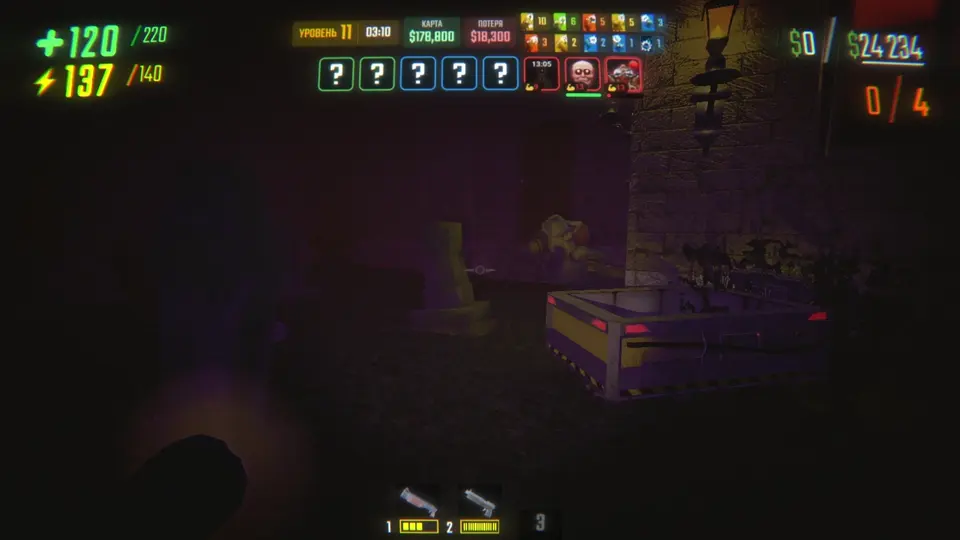
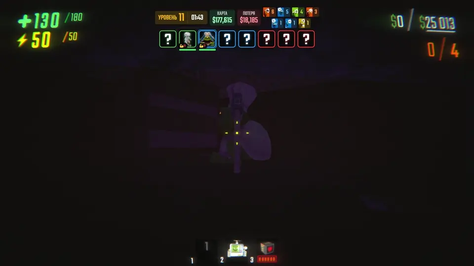
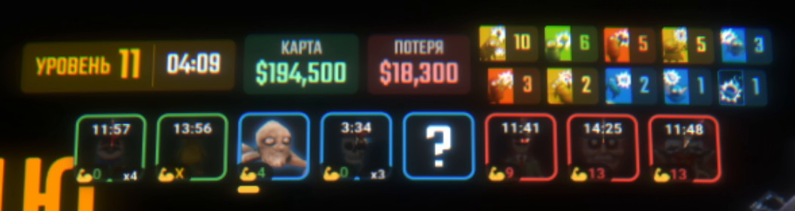
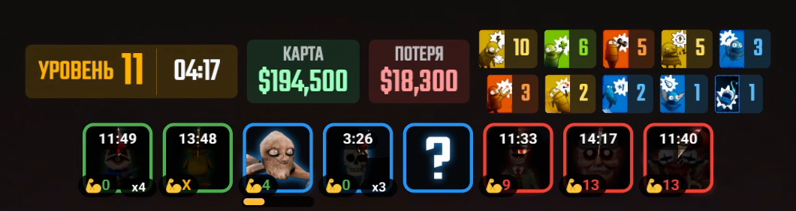

# OverlayHUD — Native

**Monster and loot tracker for R.E.P.O. / Трекер монстров и ценностей для R.E.P.O.**

AI tools including Claude and GPT were used to create OverlayHUD.

При создании OverlayHUD использовались ИИ-инструменты Claude и GPT.

[English](#english) · [Русский](#русский)

## English

Keep track of your run without leaving the game. OverlayHUD displays encountered monsters, player upgrades and valuable statistics directly inside R.E.P.O., with a customizable layout and optional visual effects.

This is the **Native edition**: the HUD is rendered through Unity, with its fonts and icons bundled into the plugin. No separate application or window is required.

### Encounters and damage

Watch the rightmost monster take a 25 HP hit and start its respawn countdown. Two unknown tiles then reveal their monsters.

### When a monster spots you

Look under the third tile. The blue eye bar fills as the monster notices you, then glows red when it spots you.

### Native game UI effects

To preview the in-game visual style, set `Style = Game` in `[Native - Appearance]` in `OverlayHUD.cfg`. Map value and losses use the level timer's typography with Taxman emoji. `WrapValueLabels` stacks map value above losses when enabled and puts the amounts side by side when disabled. Monster portraits use the inventory slot background. Health and detection bars span each portrait in six segments. When an item takes damage, the loss counter flashes and counts up to the new total. When a monster spots you, its detection bar shows three Taxman emoji in order: a monster, a watching eye, and the player. Destroyed-item alerts show the player and item in red and the word “destroyed” in white. Both styles use the `UseGameUIEffects` setting in **Native - Effects**.

**UseGameUIEffects on** · Game bloom and colour fringing

**UseGameUIEffects off** · Sharper text and icons

### Features

- **Monster information** — health bars, required grab strength, grouped counts, respawn timers and circular respawn indicators.
- **Run overview** — current level, elapsed time, remaining valuable value and losses.
- **Player upgrades** — icons for owned upgrades, with individual visibility controls.
- **Visual feedback** — proximity waves, floating damage numbers, animations and optional destroyed-item notifications showing the last holder. Each break appears on its own line for six seconds.
- **Flexible layout** — horizontal or grid layouts, alignment, offsets, scale, icon sizes, rows and columns.
- **Russian and English** — localized interface and official game names in tooltips.
- **Session timestamps** — local text logs of level starts, maps and encountered monsters.

By default, monsters are revealed **only after an encounter**. Undetected monsters remain placeholders, and receiving multiplayer data does not reveal their identities. The HUD hides while the map or quota counter is shown.

The eye bar fills in blue while a monster notices you and glows red while it sees you or still tracks you during a chase. To hide it locally, set `ShowDetectionBar = false` in `[Detection]`.

### Customization

Settings are grouped by purpose in `BepInEx/config/OverlayHUD.cfg`: detection, general HUD options, layout, information, monsters, effects and individual upgrades.

Native HUD appearance settings can be changed live through **BepInEx Configuration Manager**, if available. Manual file edits require a config reload or game restart.

- New monster artwork is enabled by default. Set `LegacyIcons = true` in **Appearance** to restore the original icons (`false` by default).
- Choose `Language = en` or `ru` in **Native - General**; Russian is the default.
- Show or hide individual HUD elements without stopping game-state tracking.
- In Classic style, for hover tooltips, enable `ShowTooltips` and disable `UseGameUIEffects` in **Native - Effects**. Tooltips work when the game cursor is unlocked; the HUD does not unlock or capture it.
- Timestamps are saved to `BepInEx/plugins/OverlayHUD/timestamps/` when `SaveTimestamps = true` (off by default).

### Multiplayer and limitations

- Accurate client-side respawn timers and health synchronization require compatible, current OverlayHUD versions on the host and clients. Health synchronization is experimental.
- Damage numbers show a monster's health loss from all sources, not an individual player's damage score.
- Game UI effects are experimental and may reduce text sharpness. In either style, disable `UseGameUIEffects` for independent, sharper rendering.
- Monsters without a dedicated icon use a placeholder. Unsupported font characters appear as `?`.
- This is an alternative edition of the same plugin, not an add-on for another OverlayHUD edition. Use only one copy per profile.

### Credits

Team monster detection was inspired by the fork by NeverFun21, [OverlayHUD Multiplayer Fix](https://github.com/NeverFun21/OverlayHUD-Multiplayer-Fix).

### Feedback

For bug reports, include `BepInEx/LogOutput.log`, your config and a short description of the issue. Optional detailed logging is available under **Diagnostics**.

[Report an issue](https://github.com/Dunweir/OverlayHUD-repo/issues) · [Source code and detailed documentation](https://github.com/Dunweir/OverlayHUD-repo)

---

## Русский

Следите за забегом, не выходя из игры. OverlayHUD показывает встреченных монстров, улучшения игрока и статистику ценностей прямо внутри R.E.P.O. Расположение, состав HUD и визуальные эффекты можно настроить под себя.

Это **Native-версия**: HUD рисуется средствами Unity, а шрифты и иконки встроены в плагин. Отдельное приложение или окно не требуется.

### Возможности

- **Информация о монстрах** — полоски здоровья, требуемая сила захвата, количество в группе, таймеры и круговые индикаторы респавна.
- **Состояние забега** — текущий уровень, время прохождения, оставшаяся стоимость ценностей и потери.
- **Улучшения игрока** — иконки полученных улучшений с отдельными переключателями видимости.
- **Визуальные подсказки** — волны близости, всплывающие числа урона, анимации и включаемые уведомления об уничтоженных предметах с именем последнего державшего их игрока. Каждая поломка появляется отдельной строкой на шесть секунд.
- **Гибкое расположение** — горизонтальный HUD или сетка, выравнивание, смещения, масштаб, размеры иконок, ряды и колонки.
- **Русский и английский языки** — локализованный интерфейс и официальные игровые названия в подсказках.
- **Таймкоды сессии** — локальные текстовые записи начала уровней, карт и встреченных монстров.

По умолчанию монстры раскрываются **только после встречи**. Необнаруженные виды остаются заглушками, а получение данных в мультиплеере не раскрывает их названия. HUD скрывается при просмотре карты и показе счётчика квоты.

Полоска с глазом заполняется голубым, пока монстр замечает вас, и светится красным, пока он видит вас или продолжает отслеживать в погоне. Чтобы скрыть её у себя, установите `ShowDetectionBar = false` в секции `[Detection]`.

### Настройка

Параметры находятся в `BepInEx/config/OverlayHUD.cfg` и сгруппированы по назначению: обнаружение, общие настройки HUD, расположение, информация, монстры, эффекты и отдельные улучшения.

Внешний вид Native HUD можно менять на лету через **BepInEx Configuration Manager**, если он доступен. После ручного редактирования файла требуется перезагрузить конфиг или игру.

- Новые иконки монстров включены по умолчанию. Установите `LegacyIcons = true` в **Appearance**, чтобы вернуть прежние (`false` по умолчанию).
- Язык выбирается параметром `Language = ru` или `en` в **Native - General**; по умолчанию — русский.
- Отдельные элементы HUD можно скрывать, не останавливая отслеживание состояния игры.
- Для подсказок при наведении выберите стиль `Classic`, включите `ShowTooltips` и отключите `UseGameUIEffects` в **Native - Effects**. Подсказки работают при разблокированном игровом курсоре; сам HUD не разблокирует и не перехватывает его.
- Таймкоды сохраняются в `BepInEx/plugins/OverlayHUD/timestamps/`; запись включается параметром `SaveTimestamps = true` и по умолчанию выключена.

### Мультиплеер и ограничения

- Для точных таймеров респавна у клиента и синхронизации ХП нужны совместимые актуальные версии OverlayHUD у хоста и клиентов. Синхронизация ХП экспериментальная.
- Числа урона показывают потерю здоровья монстра от всех источников, а не личный урон игрока.
- Эффекты игрового интерфейса экспериментальные и могут снижать чёткость текста. В обоих стилях можно отключить `UseGameUIEffects` для независимого, более чёткого вывода.
- Монстры без собственной иконки отображаются с заглушкой. Неподдерживаемые шрифтом символы заменяются на `?`.
- Это альтернативная версия того же плагина, а не дополнение к другой сборке OverlayHUD. В профиле должна быть только одна копия.

### Благодарности

Спасибо NeverFun21 за идею командного обнаружения монстров в форке [OverlayHUD Multiplayer Fix](https://github.com/NeverFun21/OverlayHUD-Multiplayer-Fix).

### Обратная связь

К сообщению об ошибке приложите `BepInEx/LogOutput.log`, конфиг и краткое описание проблемы. Подробные логи можно включить в секции **Diagnostics**.

[Сообщить об ошибке](https://github.com/Dunweir/OverlayHUD-repo/issues) · [Исходники и подробная документация](https://github.com/Dunweir/OverlayHUD-repo)

---

**Author / Автор: EgorSalad**

Unofficial fan project; not affiliated with semiwork, the publisher of R.E.P.O. or Thunderstore.

Неофициальный фанатский проект; не связан с semiwork, издателем R.E.P.O. или Thunderstore.

Code / Код: **MIT**. Fonts and game artwork retain their respective licenses and rights; see `LICENSE` and `THIRD_PARTY_NOTICES.md`.

Шрифты и игровые изображения сохраняют собственные лицензии и права; см. `LICENSE` и `THIRD_PARTY_NOTICES.md`.
